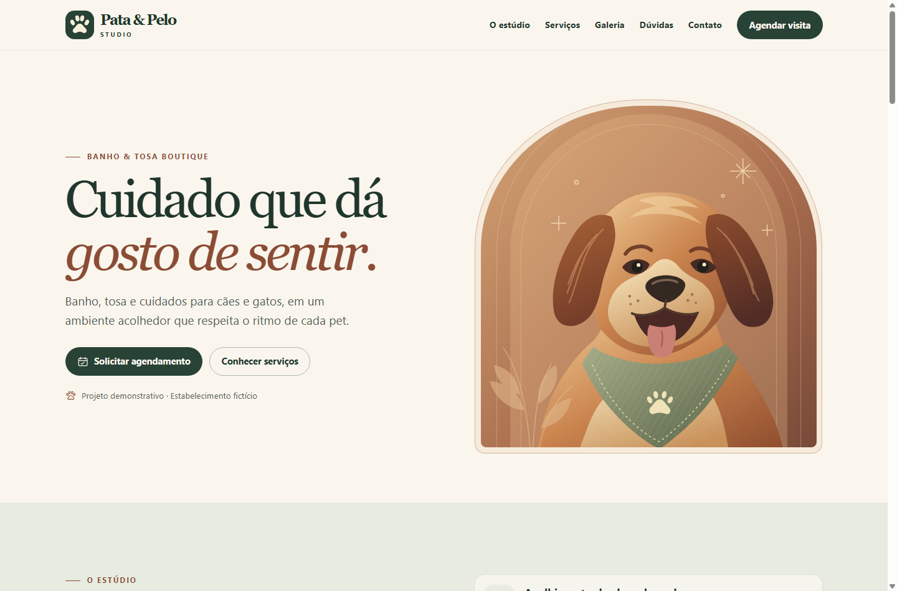
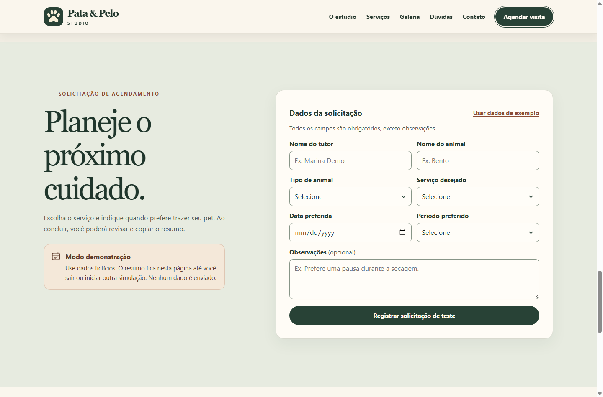
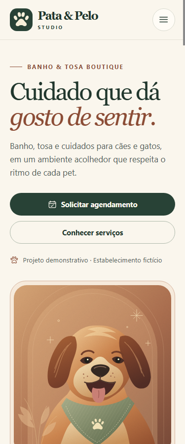

# Nadani Business Landing

**Pata & Pelo Studio** é uma landing page de portfólio da Nadani Productions para apresentar serviços de banho, tosa e cuidados estéticos para cães e gatos. O estabelecimento, seus preços e seus horários são fictícios.

## Capturas de tela

**Desktop · 1440 px**



**Agendamento demonstrativo · 1440 px**



**Mobile · 375 px**



## Funcionalidades

- Cabeçalho fixado no topo, menu mobile operável por teclado, navegação por âncoras e indicação da seção ativa.
- Apresentação do estúdio, cinco serviços com valores ilustrativos, diferenciais, galeria, FAQ, horários e rodapé com crédito.
- Galeria responsiva com ampliação, navegação por botões e setas, fechamento por Escape, botão ou clique fora e retorno de foco.
- FAQ com elementos nativos de expansão.
- Formulário com pré-seleção de serviço, dados fictícios de exemplo, mensagens por campo, validação de datas e proteção contra submissões repetidas.
- Resumo copiável com opção de seleção manual quando a área de transferência estiver indisponível.
- Indicadores de foco, link para pular a navegação, textos alternativos, carregamento tardio das imagens da galeria e suporte à preferência por movimento reduzido.

## Tecnologias e estrutura

HTML5 semântico, CSS3 com Grid e Flexbox, JavaScript ES6+ em módulos e SVG. O site é servido como arquivos estáticos, com fontes do sistema e todos os recursos visuais locais. Node.js é usado para executar os testes e o servidor de desenvolvimento.

```text
nadani-business-landing/
├── index.html
├── css/
│   ├── style.css
│   └── responsive.css
├── js/
│   ├── app.js
│   ├── booking.js
│   └── config.js
├── assets/
│   ├── icons/
│   └── images/
├── docs/screenshots/
├── tests/
├── tools/serve.mjs
├── package.json
├── .nojekyll
├── README.md
└── LICENSE
```

## Instalação e execução local

Baixe ou clone o projeto e abra um terminal na pasta `nadani-business-landing`. Para usar o servidor incluído, instale Node.js 22 ou superior. O projeto dispensa `npm install` e etapa de build.

```sh
npm start
```

Abra `http://127.0.0.1:4173/nadani-business-landing/`. O prefixo simula a hospedagem em um subdiretório no GitHub Pages. Use um servidor HTTP local para carregar os módulos ES, pois o acesso via `file://` pode bloqueá-los.

## Personalização

| O que alterar | Onde editar |
| --- | --- |
| Marca, título SEO, textos e chamadas | `index.html`, incluindo o cabeçalho e o rodapé |
| Logotipo e ícones | `assets/icons/favicon.svg` e `assets/icons/ui.svg` |
| Cores, fontes e espaçamentos | Variáveis em `css/style.css` |
| Layout por largura | `css/responsive.css` |
| Serviços e preços | Cartões em `index.html`. Mantenha o identificador do atributo `data-service` igual ao `value` da opção correspondente no formulário. Atualize também o rodapé e a resposta do FAQ sobre serviços. |
| Campos, períodos e horários | Opções do formulário, seção de contato e rodapé em `index.html` |
| Prazo de seleção de datas e dados de exemplo | `js/config.js`. Ao trocar opções, mantenha os identificadores do exemplo compatíveis. |
| Galeria | SVGs em `assets/images/`, com os respectivos textos alternativos e legendas no HTML |
| Contato e crédito | Seções de contato e rodapé em `index.html` |

## Limitações da demonstração

- Use os dados de exemplo. A página mantém o resumo em memória até recarregar, sair ou iniciar outra simulação. O botão de cópia transfere o texto para a área de transferência quando o navegador permite.
- A data pode ser escolhida entre hoje e os próximos 90 dias. Os horários exibidos no site são ilustrativos e o formulário não consulta disponibilidade.
- A simulação não envia dados, confirma visitas ou utiliza backend, WhatsApp ou armazenamento persistente. O estúdio não possui canal comercial.

## Testes

```sh
npm test
npm run test:browser
npm run test:browser -- --screenshots
```

A suíte de navegador usa Chrome, Chromium ou Edge em modo headless. Para indicar outro caminho, configure a variável de ambiente `BROWSER_PATH`. O último comando atualiza as capturas do README.

| Verificação executada | Resultado |
| --- | --- |
| Seis testes unitários em Node.js 24 | Passaram. Cobrem campos obrigatórios, opções inválidas, limites de data, calendário local e formatação do resumo. |
| Chrome headless em 320, 375, 768, 1024 e 1440 px | Passou. Verificou ausência de rolagem horizontal, adaptação de navegação e hero, e movimento reduzido. As três capturas foram revisadas visualmente. |
| Interações em Chrome headless | Passaram. Âncoras, seção ativa, menu por teclado, FAQ, modal, fechamento, foco, seleção dos serviços, erros de formulário, dados de exemplo, bloqueio de duplicidade e nova simulação. |
| Cópia do resumo | Passou com a API da área de transferência simulada nos cenários de sucesso e permissão negada. |
| Hospedagem estática local no subdiretório | Passou. Destinos internos, caminhos relativos, carregamento e decodificação das imagens, ausência de erros HTTP e JavaScript e ausência de requisições de envio do formulário. |
| Inspeção de arquivos | A busca por padrões comuns de credenciais não retornou ocorrências nos arquivos do projeto. |

O Lighthouse e os testes em dispositivos físicos ou outros motores de navegador ficaram pendentes.

## Publicação no GitHub Pages

1. Quando autorizado, crie um repositório público chamado `nadani-business-landing` no GitHub e envie os arquivos à branch `main`.
2. No repositório, abra **Settings → Pages**.
3. Em **Build and deployment**, selecione **Deploy from a branch**, escolha **main** e **/(root)** e salve.
4. Após o deploy, abra a URL apresentada em **Settings → Pages** e verifique as imagens, as âncoras e o formulário. O endereço padrão do site de projeto usa o formato `https://<usuário>.github.io/nadani-business-landing/`.

O arquivo `.nojekyll` e os caminhos relativos permitem publicar a raiz do projeto como arquivos estáticos. Consulte a [documentação oficial do GitHub Pages](https://docs.github.com/en/pages/getting-started-with-github-pages/configuring-a-publishing-source-for-your-github-pages-site).

### About do repositório

> Premium responsive business landing page built with HTML, CSS and JavaScript. Portfolio demonstration by Nadani Productions.

## Licença e crédito

O código e os SVGs originais foram produzidos para este projeto e são distribuídos sob a [licença MIT](LICENSE). As capturas foram geradas da própria página. O projeto usa ilustrações, ícones e logotipo próprios, sem fotografias ou fontes de terceiros.

[Demo project developed by Nadani Productions](https://nadani.space)
